# Q4. Kaggle: 노이즈가 있는 Covertype 분류

## 요약

| 항목 | 내용 |
|---|---|
| 최종 모델 | **ExtraTrees + 새 feature 12개 + 노이즈 의심 레이블 25% 제거** |
| CV accuracy | **0.6031 ± 0.0031** (seed 3개 × 5-fold = 점수 15개의 평균) |
| Baseline 대비 | 0.3880 → 0.6031 (**+0.2151**) |
| Kaggle public LB | [직접 기록] |
| Kaggle private LB | [직접 기록] |
| 최종 제출 코드 | `Code/kaggle/final_submission.py` (실행하면 제출 파일을 똑같이 다시 만듦) |

**핵심 발견 3가지**

1. **모델 튜닝과 앙상블은 금방 한계에 도달했다.**
   - 1~3단계에서 약 700개 설정을 시험하고 모델을 섞어도 CV는 0.5786 → 0.5803(**+0.0017**)만 올랐다.
2. **입력 데이터를 바꾸는 것이 훨씬 효과적이었다.**
   - 새 feature 추가, ExtraTrees, 노이즈 레이블 제거로 0.5803 → 0.6031(**+0.0228**)이 올랐다. 모델 쪽 개선의 약 13배다.
3. **train 레이블의 약 18%가 노이즈로 추정된다.**
   - 노이즈는 수가 적은 클래스(4, 5번)에 특히 많은 것으로 보인다.

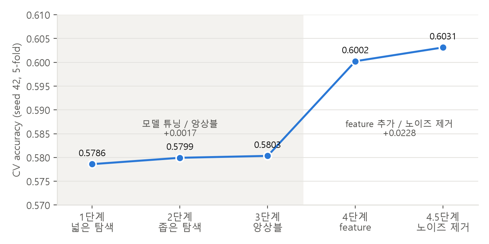

*그림 1. 단계별 최고 CV accuracy. 회색 구간(1~3단계)은 모델만 바꾼 구간이고, 4단계부터는 데이터(feature, 레이블)를 바꿨다. Baseline(0.3880)은 축 범위 밖이라 생략했다.*

---

## 1. 문제와 데이터

### 1.1 과제
- 숲의 지형 정보 54개(feature)로 **나무 종류(Cover_Type, 1~7번)**를 맞히는 **다중 분류** 문제다.
- 데이터에 일부러 **노이즈**를 넣어 두었다.
  - 그래서 "노이즈까지 외우지 않는 모델(과적합 방지)"을 만드는 것이 핵심이다.

| 항목 | 내용 |
|---|---|
| train | 30,000개 (정답 레이블 있음) |
| test | 20,000개 (정답 없음, Kaggle이 채점) |
| 숫자 feature 10개 | 고도(Elevation), 방향(Aspect), 경사(Slope), 수원지까지 수평/수직 거리, 도로까지 거리, 산불 지점까지 거리, 그늘 3개(9시, 12시, 15시) |
| 범주 feature 44개 | 구역(Wilderness_Area) 4개 열, 토양(Soil_Type) 40개 열. 해당하는 열만 1이고 나머지는 0 (one-hot) |
| 평가 | public LB = test의 40%, private LB(최종 순위) = test의 60% |

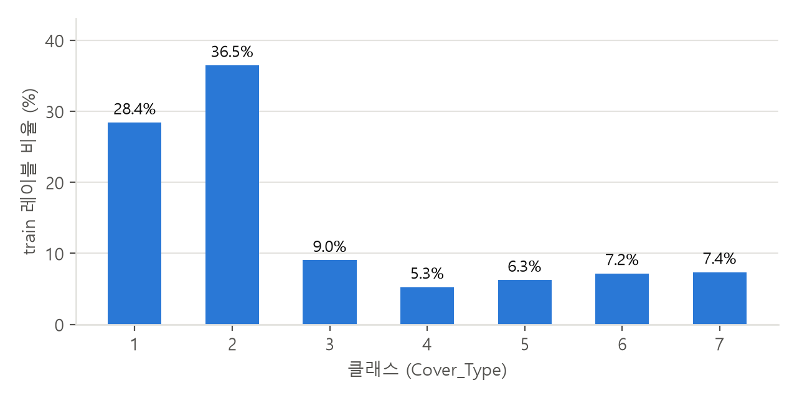

*그림 2. train 레이블의 클래스 비율. 1, 2번이 65%로 클래스 불균형이 있다.*

### 1.2 데이터에서 확인한 노이즈
- **숫자 feature의 노이즈:** 원래 정수인 값(고도, 거리 등)에 소수점이 붙어 있고, 범위 끝에서 잘린 값이 있다.
- **범주 feature는 깨끗하다:** 구역 4개 열과 토양 40개 열은 모든 행에서 정확히 하나만 1이다.
- **레이블 노이즈:** 아무 제한이 없는 Decision Tree는 train 정확도가 **100%**인데, 처음 보는 데이터에서는 **38.8%**밖에 안 된다. 노이즈까지 모두 외웠다는 뜻이다.

> **용어: 과적합(overfitting)**
> - 학습 데이터를 너무 자세히 외워서, 처음 보는 데이터에서는 오히려 성능이 떨어지는 현상이다.
> - 노이즈가 많은 데이터에서는 "노이즈를 외우는 것"이 곧 과적합이다.

---

## 2. 평가 방법: Stratified 5-fold 교차 검증(CV)

### 2.1 Kaggle 점수로 모델을 고르지 않은 이유
- **제출이 하루 2번으로 제한**되어 있어서 수백 개의 설정을 비교할 수 없다.
- public LB는 test의 40%(8,000개)만으로 채점해서 운에 따라 **±0.005 정도 흔들린다.**
  - public LB에 맞춰 고르면 최종 순위인 private LB에서 손해를 볼 수 있다.
- 그래서 **모든 비교는 train 안에서 교차 검증(CV)으로 하고**, Kaggle에는 단계별 최고 모델만 제출했다.

### 2.2 5-fold CV 방법
train을 5조각으로 나누고, 한 조각씩 돌아가며 검증용으로 쓴다.

| 회차 | 조각 1 | 조각 2 | 조각 3 | 조각 4 | 조각 5 |
|---|---|---|---|---|---|
| 1회 | **검증** | 학습 | 학습 | 학습 | 학습 |
| 2회 | 학습 | **검증** | 학습 | 학습 | 학습 |
| 3회 | 학습 | 학습 | **검증** | 학습 | 학습 |
| 4회 | 학습 | 학습 | 학습 | **검증** | 학습 |
| 5회 | 학습 | 학습 | 학습 | 학습 | **검증** |

- **CV accuracy = 검증 정확도 5개의 평균**이다. 30,000개가 모두 한 번씩 검증에 쓰여서, 한 번만 나눠 평가하는 것보다 믿을 만하다.
- **Stratified:** 각 조각의 클래스 비율을 전체와 같게 맞춘다.
- **seed 42 고정:** 모든 단계에서 똑같이 나눠서 단계 간 점수를 그대로 비교할 수 있다.
- **k = 5인 이유:** 학습에 80%(24,000개)를 써서 데이터를 충분히 쓰면서, 실험 시간도 감당할 수 있다.

### 2.3 함께 기록한 값

| 값 | 의미 |
|---|---|
| **CV accuracy** | 처음 보는 데이터에서의 정확도. **모델 선택 기준** |
| CV macro F1 | 클래스마다 F1을 구해 평균. 작은 클래스도 똑같이 중요하게 봄 |
| train accuracy | 학습한 데이터를 다시 맞힌 정확도 |
| gap = train − CV | 클수록 학습 데이터를 많이 외웠다는 신호 |

---

## 3. 0단계: Baseline (과제 기본 코드)
- **모델:** Decision Tree 기본값 (깊이 제한 없음)
- **결과:** CV accuracy **0.3880**, train accuracy 1.0000 (gap 0.612)
  - 기본 노트북처럼 75/25로 한 번 나눠 평가하면 0.3931이다.
- 트리가 끝까지 자라서 **노이즈 샘플 하나하나까지 따로 외웠다.** 이후 모든 단계를 이 점수와 비교했다.

---

## 4. 1단계: 넓은 범위 탐색 (289개 설정)

### 4.1 한 일
- 수업에서 배운 모델 5종류를 **넓은 범위**의 하이퍼파라미터로 모두 평가해서 "어떤 모델이 유망한지" 찾았다.

| 모델 | 탐색한 하이퍼파라미터 | 설정 수 |
|---|---|---|
| Decision Tree | 최대 깊이 6가지 × 잎 최소 샘플 수 5가지 × 분할 기준 2가지 × 클래스 가중치 2가지 | 120 |
| Random Forest (트리 300개) | split마다 보는 feature 비율 4가지 × 잎 최소 샘플 수 6가지 × 클래스 가중치 2가지 | 48 |
| Bagging | 잎 최소 샘플 수 6가지 × 클래스 가중치 2가지 | 12 |
| AdaBoost | 기본 트리 깊이 4가지 × 트리 수 3가지 × 학습률 3가지 | 36 |
| HistGradientBoosting | 학습률 3 × 잎 개수 3 × 잎 최소 샘플 수 2 × L2 규제 2 × 클래스 가중치 2 | 72 |

> **용어: 하이퍼파라미터**
> - 사람이 학습 전에 정하는 설정값이다.
>   - `max_depth`: 트리 최대 깊이
>   - `min_samples_leaf`: 잎(마지막 칸) 하나에 들어가야 하는 최소 샘플 수
>   - `max_features`: split마다 후보로 보는 feature 비율
> - 깊이를 줄이거나 잎을 크게 하면 트리가 단순해져서 **노이즈를 덜 외운다.**

> **용어: 앙상블**
> - 여러 모델의 예측을 합치는 방법이다.
>   - **Bagging, Random Forest:** 데이터를 조금씩 다르게 뽑아 만든 트리 여러 개의 예측을 평균
>   - **Boosting(AdaBoost, HistGradientBoosting):** 앞 트리가 틀린 샘플을 다음 트리가 고쳐 나감

### 4.2 결과

| 모델 | 최고 CV acc | train acc | gap | 최고 설정 |
|---|---|---|---|---|
| **Random Forest** | **0.5786** | 0.9236 | 0.345 | max_features 0.2, min_samples_leaf 2 |
| Bagging | 0.5762 | 0.9841 | 0.408 | min_samples_leaf 2 |
| HistGradientBoosting | 0.5597 | 0.6480 | 0.088 | 학습률 0.1, 잎 63개, min_samples_leaf 20, L2 1 |
| AdaBoost | 0.5503 | 0.6573 | 0.107 | 기본 트리 깊이 10, 트리 500개, 학습률 0.1 |
| Decision Tree | 0.5201 | 0.5739 | 0.054 | max_depth 12, min_samples_leaf 20 |
| Baseline | 0.3880 | 1.0000 | 0.612 | 기본값 |

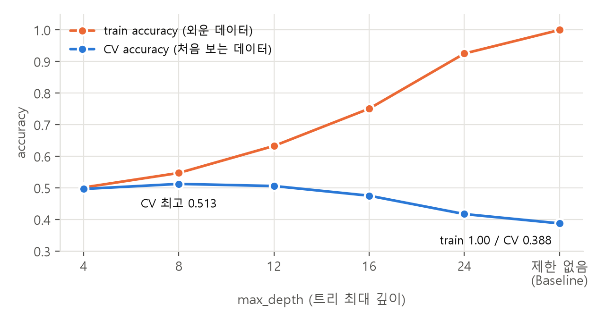

*그림 3. Decision Tree의 깊이에 따른 정확도. 트리가 깊어질수록 train 정확도(주황)는 100%까지 오르지만, 처음 보는 데이터의 정확도(파랑)는 깊이 8 이후 계속 떨어진다. 과적합을 그대로 보여 준다.*

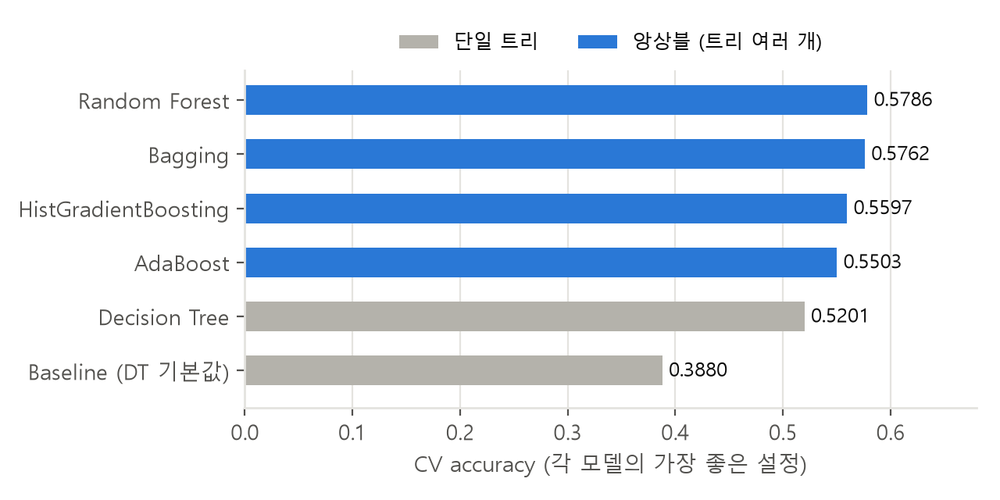

*그림 4. 모델별 최고 CV accuracy. 앙상블(파랑) 4개 모두 단일 트리(회색)보다 높다.*

### 4.3 알게 된 점
- **트리 크기만 제한해도 크게 좋아진다.**
  - 깊이 8: 0.388 → 0.513
  - 잎 최소 샘플 수 50: 0.388 → 0.514
- **앙상블은 모두 단일 트리보다 좋았다.**
  - Random Forest는 gap이 0.345로 커서 train을 많이 외웠는데도 CV가 가장 높았다.
  - 트리마다 외운 노이즈가 서로 달라서, 평균을 내면 노이즈가 상쇄되기 때문이다.
- **클래스 가중치(`class_weight='balanced'`)는 모든 모델에서 손해였다** (Random Forest 0.5786 → 0.5220).
  - 작은 클래스를 더 중요하게 학습시키는 방법인데, 이 데이터에서는 작은 클래스 레이블에 노이즈가 많아서(9.2절) 오히려 노이즈를 더 중요하게 학습한 것으로 보인다.
- HistGradientBoosting은 최고 설정이 탐색 범위 끝에 있어서 2단계에서 범위를 넓혔다.

---

## 5. 2단계 + 2.5단계: 좁은 범위 정밀 탐색 (404개 설정)

### 5.1 한 일
- **2단계:** 1단계 상위 모델 주변을 촘촘하게 탐색했다.
  - Random Forest 144개 + 트리 수 600, 1000개 확인
  - HistGradientBoosting 216개
- **2.5단계:** 정확도가 낮지 않았던 Bagging(24개)과 AdaBoost(18개)도 더 깊게 탐색했다. 모델끼리 공정하게 비교하기 위해서다.

### 5.2 결과

| 모델 | 1단계 | 2 / 2.5단계 | 변화 | 최고 설정 |
|---|---|---|---|---|
| **Random Forest** | 0.5786 | **0.5799** | +0.0013 | 트리 1000개, max_features 0.2, min_samples_leaf 2, entropy |
| HistGradientBoosting | 0.5597 | 0.5723 | +0.0126 | 학습률 0.03, 잎 255개, min_samples_leaf 5, max_features 0.5 |
| Bagging | 0.5762 | 0.5762 | 0 | 1단계와 같음 |
| AdaBoost | 0.5503 | 0.5694 | +0.0191 | 기본 트리 깊이 20, min_samples_leaf 5, 트리 300개, 학습률 0.1 |

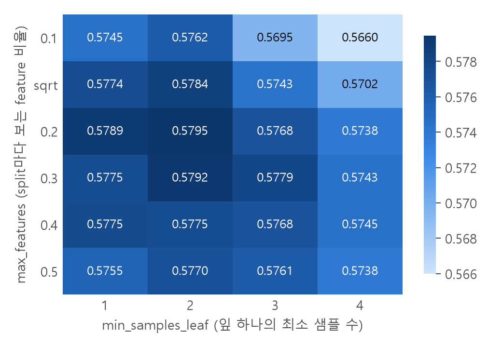

*그림 5. Random Forest의 max_features × min_samples_leaf별 CV accuracy. 0.57~0.58 사이의 넓은 "평평한 지대"가 있다.*

### 5.3 알게 된 점
- **Random Forest는 이미 최고점 근처였다.**
  - 144개 설정 중 79개가 최고점과 1 표준편차 이내였다. 설정을 더 바꿔도 의미 있는 향상이 어렵다는 뜻이다.
- HistGradientBoosting과 AdaBoost는 많이 올랐지만 여전히 Random Forest보다 낮았다.
- **Kaggle 제출:** 1단계 Random Forest **0.69614**, 2단계 Random Forest **0.69705** (public LB)

---

## 6. 3단계: 서로 다른 모델 섞기 (Voting / Stacking)

### 6.1 한 일
- 2.5단계까지의 모델별 최고 설정 4개(Random Forest, Bagging, HistGradientBoosting, AdaBoost)를 섞었다.
  - **Soft Voting:** 모델들이 낸 클래스별 확률을 평균한다. 2개 이상의 모든 조합(11가지)을 평가했다.
  - **Stacking:** 4개 모델의 확률(4 × 7 = 28개 값)을 입력으로, Logistic Regression이 "어떻게 섞을지"를 학습한다.
- 차이가 작아서 **seed 3개(42, 0, 1) × 5-fold = 점수 15개**로 다시 비교했다.

### 6.2 결과

| 방법 | CV acc (15개 평균) | Random Forest 대비 | 15개 fold 중 RF보다 높았던 횟수 |
|---|---|---|---|
| **Stacking (4개 모델)** | **0.5803** | +0.0007 | 11 |
| Voting: RF + Bagging | 0.5803 | +0.0007 | 9 |
| Random Forest 단독 | 0.5797 | 0 | - |
| Voting: 4개 모두 | 0.5794 | −0.0003 | 7 |
| Voting: RF + HistGB | 0.5777 | −0.0019 | 2 |
| HistGradientBoosting 단독 | 0.5722 | −0.0074 | 0 |

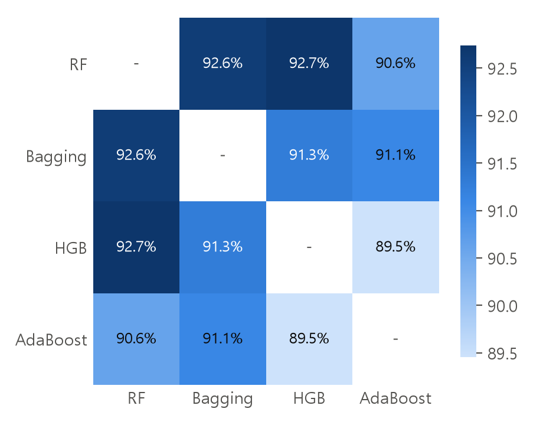

*그림 6. 모델끼리 test 예측이 같은 비율. 어떤 두 모델을 골라도 90% 안팎이 같다.*

### 6.3 알게 된 점
- **섞어도 거의 좋아지지 않았다** (+0.0007).
  - 앙상블은 모델들이 **서로 다른 곳에서 틀릴 때** 효과가 있다.
  - 그런데 여기서는 모델끼리 예측이 89.5~92.7% 같아서, 대부분 **같은 샘플에서 함께 틀린다.**
- **결론:** 같은 입력 feature를 쓰는 한, 모델 쪽 개선은 한계에 도달했다. 그래서 4단계에서는 **입력 데이터 자체를 바꾸기로** 했다.

---

## 7. 4단계: Feature 바꾸기 + ExtraTrees (100개 설정)

### 7.1 한 일
**(1) feature 세트 4개 비교 (2 × 2 설계)**
- "one-hot 압축"과 "새 feature 추가"를 각각 켜고 끈 4가지를 비교했다. 그래서 각 방법의 효과를 따로 볼 수 있다.

| 세트 | 내용 | feature 수 |
|---|---|---|
| A | 원래 그대로 | 54 |
| B | one-hot 압축: 토양 40개 열 → "토양 번호" 1개 열, 구역 4개 열 → "구역 번호" 1개 열 | 12 |
| C | 원래 54개 + 새 feature 12개 | 66 |
| D | 압축 12개 + 새 feature 12개 | 24 |

**(2) 새로 만든 feature 12개**

| 새 feature | 계산 | 의미 |
|---|---|---|
| Elev_minus_VHyd | 고도 − 수원지까지 수직거리 | 가장 가까운 수원지의 고도 |
| Elev_minus_HHyd | 고도 − 0.2 × 수원지까지 수평거리 | 수평거리로 보정한 고도 |
| Hyd_distance | √(수평거리² + 수직거리²) | 수원지까지 직선거리 |
| Hyd/Fire/Road 합·차 6개 | 예: 수원지 거리 + 산불 거리, \|수원지 거리 − 산불 거리\| | 세 거리(수원지, 도로, 산불 지점)끼리의 합과 차 |
| Aspect_sin, Aspect_cos | sin(방향), cos(방향) | 0°와 360°는 같은 방향인데 숫자로는 멀다 → 원 위의 좌표로 변환 |
| Hillshade_mean | 그늘 3개의 평균 | 하루 평균 그늘 |

- **새 feature가 도움이 되는 이유 1:** 트리는 한 번에 **feature 하나만** 보고 나눈다.
  - "고도 − 거리" 같은 관계를 원래 feature로 표현하려면 split이 여러 번 필요하다.
  - 계산해서 넣어 주면 split 한 번으로 표현할 수 있다.
- **새 feature가 도움이 되는 이유 2:** 노이즈가 있는 값 여러 개를 더하거나 평균하면 노이즈가 일부 상쇄된다.

**(3) 모델:** ExtraTrees(새로 시도), Random Forest, HistGradientBoosting

> **ExtraTrees (Extremely Randomized Trees)**
> - Random Forest와 거의 같지만, split 기준값을 **최적값이 아니라 무작위로** 정한다.
>   - Random Forest: "고도 ≤ 2,953.7"처럼 train에서 가장 잘 나누는 값을 찾는다. 이 값은 노이즈 샘플에 맞춰질 수 있다.
>   - ExtraTrees: 무작위로 뽑은 값으로 나눈다. 트리 하나하나는 대충 나누지만 노이즈에 덜 맞춰지고, 여러 개를 평균하면 정확해진다.

### 7.2 결과

| feature 세트 | ExtraTrees | Random Forest | HistGB |
|---|---|---|---|
| A 원래 그대로 (54개) | 0.5847 | 0.5795 | 0.5723 |
| B one-hot 압축 (12개) | 0.5872 | 0.5760 | 0.5701 |
| **C 새 feature 추가 (66개)** | **0.6002** | **0.5924** | **0.5832** |
| D 압축 + 새 feature (24개) | 0.5981 | 0.5897 | 0.5815 |

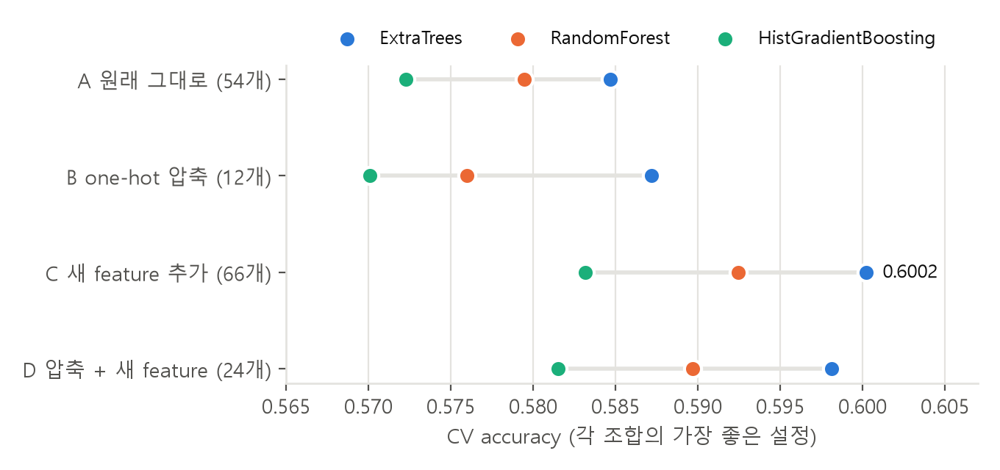

*그림 7. feature 세트 × 모델별 최고 CV accuracy. C(새 feature 추가)에서 세 모델이 모두 가장 높고, 모든 세트에서 ExtraTrees(파랑)가 가장 높다.*

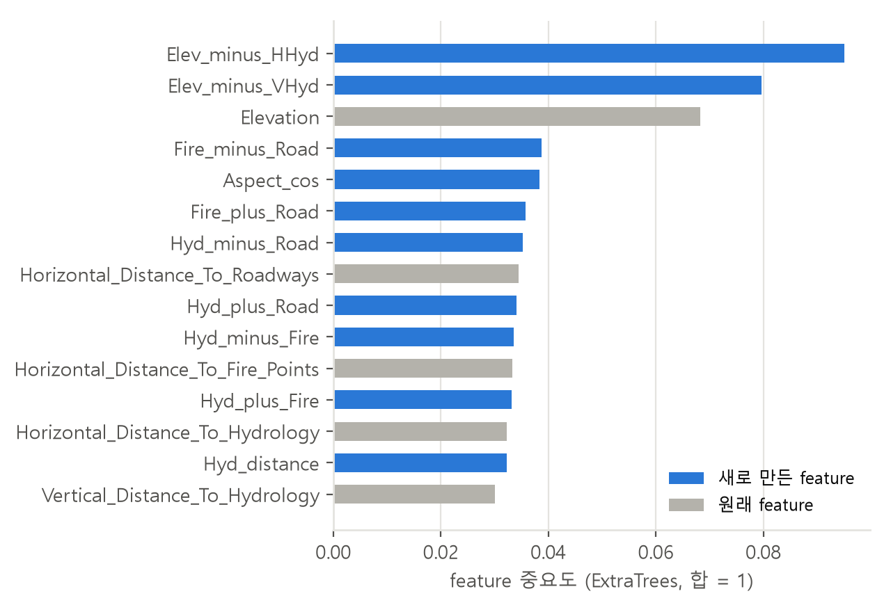

*그림 8. 4단계 최고 모델(ExtraTrees + C)의 feature 중요도 상위 15개. 파란색이 새로 만든 feature다.*

### 7.3 알게 된 점
- **새 feature의 효과가 컸다.** A → C로 바꾸면 세 모델 모두 +0.011~0.016 올랐다. 1~3단계 전체 향상(+0.0017)보다 훨씬 크다.
- **새 feature가 실제로 쓰였다.**
  - 중요도 상위 15개 중 **10개가 새 feature**다.
  - 1, 2위(고도 − 수평거리, 고도 − 수직거리)는 원래 가장 중요했던 고도(Elevation)보다도 위다.
- **one-hot 압축은 효과가 없거나 손해였다.** 그래서 **C 세트를 그대로 쓰기로** 했다.
- **ExtraTrees는 모든 세트에서 Random Forest보다 +0.005~0.011 높았다.**
  - 무작위 split이 노이즈에 덜 맞춰지기 때문으로 보인다.
  - 단, 잎 최소 샘플 수가 1이면 0.57까지 떨어진다. ExtraTrees도 어느 정도는 단순하게 만들어야 한다(그림 9).
- 최고 설정(max_features 0.7, min_samples_leaf 4)이 탐색 범위의 끝이라서 4.5단계에서 범위를 넓혔다.

---

## 8. 4.5단계: 탐색 범위 확장 + 노이즈 레이블 제거

### 8.1 (a) ExtraTrees 탐색 범위 확장
- max_features 0.7 / 0.85 / 1.0 × min_samples_leaf 3 / 4 / 6 / 8 / 12, 그리고 트리 수 600, 1000개를 확인했다.

| max_features \ min_samples_leaf | 3 | 4 | 6 | 8 | 12 |
|---|---|---|---|---|---|
| 0.70 | **0.6015** | 0.6002 | 0.5928 | 0.5860 | 0.5769 |
| 0.85 | 0.6008 | 0.6004 | 0.5936 | 0.5878 | 0.5779 |
| 1.00 | 0.5999 | 0.6001 | 0.5958 | 0.5878 | 0.5783 |

- 최고는 **max_features 0.7, min_samples_leaf 3 → 0.6015**였다.
- 트리 수를 600개(0.6008), 1000개(0.6012)로 늘려도 좋아지지 않아서 300개를 유지했다.

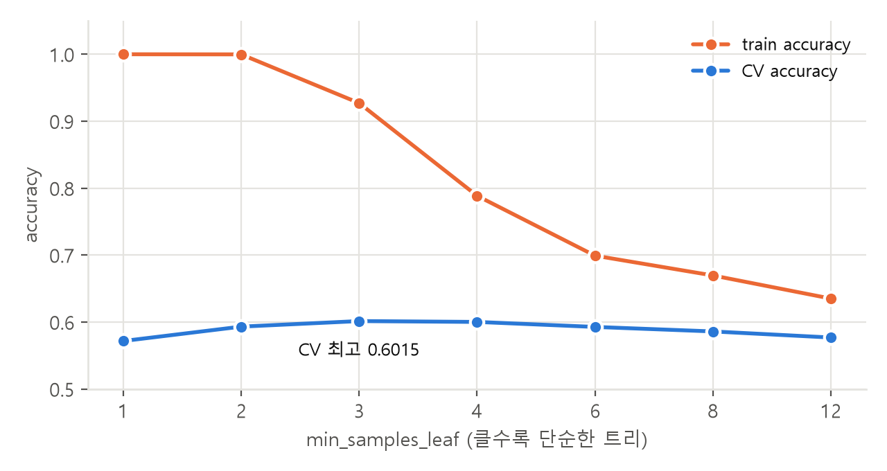

*그림 9. ExtraTrees(max_features 0.7)의 min_samples_leaf에 따른 정확도.*

- 잎이 작으면(1~2) train을 100% 외워서 CV가 낮다.
- 잎이 크면(8~12) 트리가 너무 단순해서 train과 CV가 함께 떨어진다.
- 그 사이인 **3~4가 최적**이다.

### 8.2 (b) 노이즈 레이블 제거

**아이디어**
- 레이블이 틀린 샘플을 학습에서 빼면 모델이 노이즈를 덜 배운다.
- 그런데 어떤 레이블이 틀렸는지는 모른다. 그래서 **"모델이 보기에 자기 레이블일 확률이 아주 낮은 샘플"을 노이즈로 의심**했다.

**방법** (CV의 각 회차마다 반복)
1. 학습용 80%를 다시 5조각으로 나눈다. 각 샘플에 대해, 그 샘플을 **학습에 쓰지 않은** 모델이 "자기 레이블"에 준 확률을 구한다.
   - 이렇게 구한 확률을 OOF(out-of-fold) 확률이라고 한다.
   - 학습에 쓴 샘플로 구하면 모델이 이미 외워서 확률이 높게 나오기 때문에, 반드시 학습에 안 쓴 모델로 구해야 한다.
2. 이 확률이 가장 낮은 샘플부터 일정 비율(0~30%)을 학습 데이터에서 뺀다.
3. 남은 데이터로 ExtraTrees를 학습하고, **검증용 20%는 그대로 둔 채** 평가한다.
   - 검증 데이터에서는 아무것도 빼지 않는다. 그래서 점수가 부풀려지지 않고 이전 단계와 공정하게 비교된다.
- 노이즈를 빼면 데이터가 깨끗해져서 더 자세한 트리가 나을 수 있다. 그래서 min_samples_leaf 2도 함께 확인했다.

**결과** (seed 42, 5-fold CV accuracy)

| 제거 비율 | min_samples_leaf 2 | min_samples_leaf 3 |
|---|---|---|
| 0% (제거 안 함) | 0.5932 | 0.6015 |
| 5% | 0.5957 | 0.6019 |
| 10% | 0.5963 | 0.6024 |
| 15% | 0.5982 | 0.6021 |
| 20% | 0.6021 | 0.6026 |
| **25%** | **0.6031** | 0.6027 |
| 30% | 0.6005 | 0.5972 |

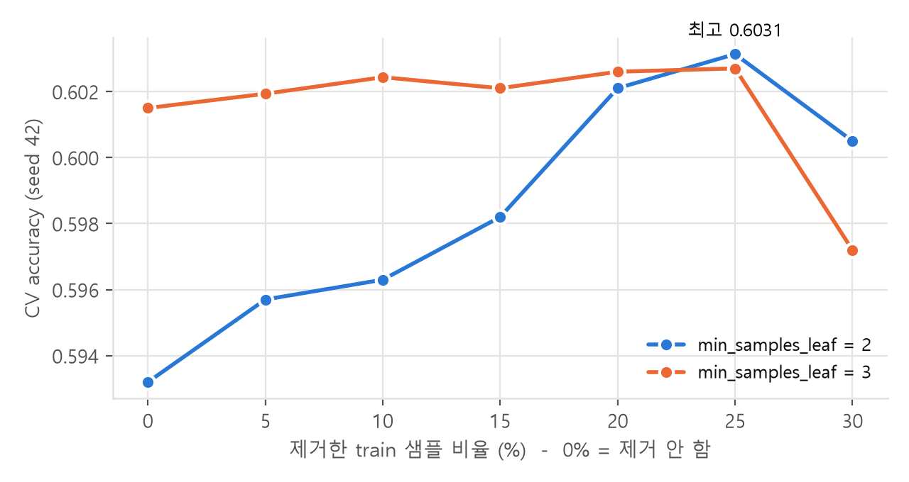

*그림 10. 제거 비율에 따른 CV accuracy. 잎 2(파랑)는 제거할수록 크게 오르다가 25%에서 최고(0.6031)가 되고, 30%에서는 떨어진다.*

- **25%까지는 뺄수록 좋아진다.** 잎 2는 0.5932 → 0.6031(+0.0099)이 올랐다.
- **30%는 너무 많이 뺀다.** 진짜 정보가 있는 샘플까지 빠져서 다시 떨어진다.
- 노이즈를 뺀 뒤에는 **잎 2가 잎 3보다 좋아졌다.** 데이터가 깨끗해져서 트리를 더 자세하게 만들어도 노이즈를 덜 외우기 때문이다.

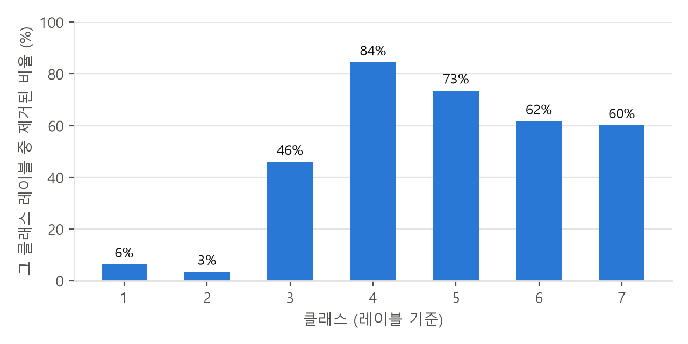

*그림 11. 25%를 제거할 때 각 클래스 레이블 중 제거된 비율 (seed 42, 5개 fold 평균).*

- 1, 2번 레이블은 3~6%만 빠졌지만, **4번은 84%, 5번은 73%**가 빠졌다.
- 수가 적은 클래스일수록 레이블 노이즈가 많다는 가설(9.2절)과 맞는다.

### 8.3 (c) 반복 CV로 최종 비교
- 차이가 작아서 3단계처럼 **seed 3개 × 5-fold = 점수 15개**로 다시 비교했다.

| 방법 | CV acc (15개 평균) | 표준편차 | CV macro F1 | 4단계 ET 대비 | 15개 fold 중 4단계 ET보다 높았던 횟수 |
|---|---|---|---|---|---|
| **ET + 노이즈 25% 제거 (4.5단계 b, 최종)** | **0.6031** | 0.0031 | **0.3880** | **+0.0027** | **14** |
| ET 범위 확장 (4.5단계 a) | 0.6014 | 0.0033 | 0.3869 | +0.0010 | 8 |
| ET + 새 feature (4단계) | 0.6004 | 0.0038 | 0.3832 | 0 | - |
| RF + 새 feature (4단계) | 0.5913 | 0.0036 | 0.3732 | −0.0091 | 0 |
| Stacking 4개 모델 (3단계) | 0.5803 | 0.0041 | 0.3591 | | |
| Voting: RF + Bagging (3단계) | 0.5803 | 0.0044 | 0.3606 | | |
| Random Forest (2단계) | 0.5797 | 0.0046 | 0.3571 | | |
| Decision Tree (1단계 설정) | 0.5201 | 0.0057 | 0.3101 | | |
| Baseline | 0.3880 | 0.0061 | 0.2589 | | |

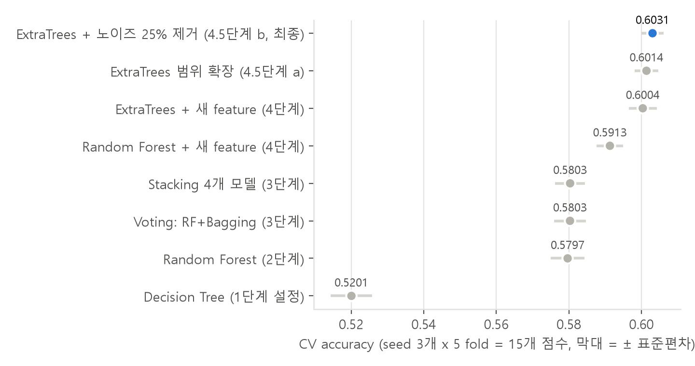

*그림 12. 최종 비교 (점 = 15개 점수의 평균, 가로 막대 = ± 표준편차). Baseline(0.3880)은 축 범위 밖이라 생략했다.*

- 노이즈 제거 모델은 **15개 fold 중 14번** 4단계 모델보다 높았다. 운이 아니라 실제 향상으로 볼 수 있어서 **최종 모델로 선택**했다.

---

## 9. CV 점수와 Kaggle 점수

### 9.1 제출 기록

| 제출 | 모델 | CV accuracy | public LB | private LB |
|---|---|---|---|---|
| 1단계 최고 | Random Forest | 0.5786 | 0.69614 | [직접 기록] |
| 2단계 최고 | Random Forest (트리 1000개) | 0.5799 | 0.69705 | [직접 기록] |
| 4단계 최고 | ExtraTrees + 새 feature | 0.6002 | [직접 기록] | [직접 기록] |
| **4.5단계 최고 (최종)** | **ExtraTrees + 새 feature + 노이즈 25% 제거** | **0.6031** | [직접 기록] | [직접 기록] |

### 9.2 Kaggle 점수가 CV보다 약 0.12 높은 이유 (추정)
- CV는 **노이즈가 섞인 train 레이블**로 채점한다.
  - 모델이 진짜 정답을 맞혀도 레이블이 틀려 있으면 오답으로 계산된다.
  - 반면 test 레이블은 더 깨끗한 것으로 보인다.
- 레이블이 무작위로 다른 6개 클래스 중 하나로 바뀌었다고 가정하면 계산할 수 있다.
  - 깨끗한 test 정확도를 a, 바뀐 레이블 비율을 ρ라고 하면: CV ≈ a × (1 − ρ) + (1 − a) × ρ / 6
  - a = 0.697(LB), CV = 0.580을 넣으면 **ρ ≈ 18%**다. train 레이블 약 5,400개가 틀린 셈이다.
- 노이즈는 모든 모델의 CV를 비슷하게 낮추므로, **CV로 모델 순위를 매기는 것은 여전히 유효하다.**
- **작은 클래스일수록 노이즈 비율이 높다 (가설)**
  - 바뀐 레이블은 클래스마다 비슷한 개수(약 850개)가 섞인다.
  - 그래서 원래 수가 적은 클래스(4번 레이블 1,577개)는 레이블의 절반 이상이 가짜일 수 있다.
- **이 가설을 뒷받침하는 근거**
  - 노이즈 제거 때 4, 5번 레이블이 대부분 빠졌다 (그림 11).
  - 최종 모델은 4, 5번을 거의 예측하지 않는다 (그림 13).
  - `class_weight='balanced'`가 손해였다 (4.3절).

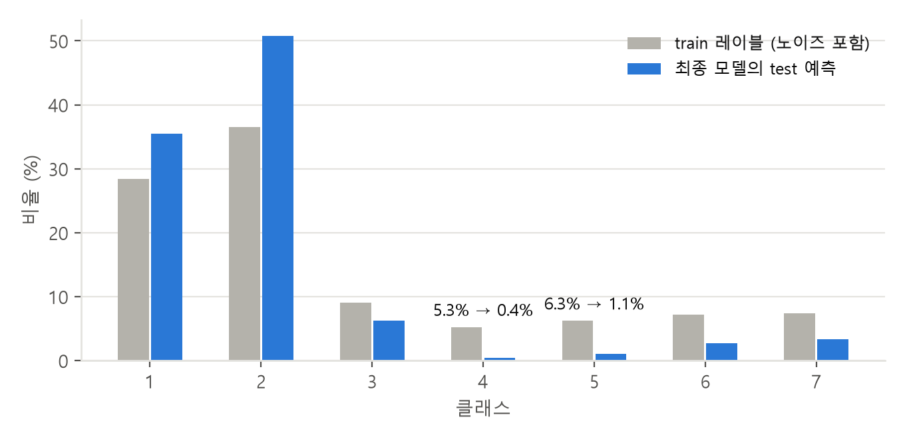

*그림 13. train 레이블 비율(회색)과 최종 모델의 test 예측 비율(파랑). 4번은 5.3% → 0.4%, 5번은 6.3% → 1.1%로, 모델은 이 클래스 레이블 대부분을 노이즈로 판단한다.*

---

## 10. 정리: 단일 모델 vs 앙상블, 그리고 노이즈 과적합 줄이기

### 10.1 단일 모델 vs 앙상블

| 종류 | 모델 | CV accuracy |
|---|---|---|
| 단일 트리 | Decision Tree 기본값 / 튜닝 | 0.3880 / 0.5201 |
| 앙상블: Boosting | AdaBoost / HistGradientBoosting | 0.5694 / 0.5723 |
| 앙상블: 평균형 | Bagging / Random Forest | 0.5762 / 0.5799 |
| 앙상블의 앙상블 | Soft Voting / Stacking | 0.5803 / 0.5803 |
| 평균형 + 새 feature | ExtraTrees + 새 feature + 노이즈 제거 (최종) | **0.6031** |

- **앙상블은 단일 트리보다 확실히 좋다** (0.5201 → 0.58 이상).
- **노이즈 데이터에서는 평균형(Bagging, Random Forest, ExtraTrees)이 Boosting보다 좋았다.**
  - Boosting은 "틀린 샘플"을 점점 더 집중해서 학습한다.
  - 노이즈 데이터에서 틀린 샘플은 상당수가 레이블이 잘못된 샘플이라서, 노이즈를 집중해서 학습하게 된다.
- **서로 다른 모델을 다시 섞는 것(Voting, Stacking)은 거의 효과가 없었다.** 모델들이 같은 곳에서 틀리기 때문이다.

### 10.2 노이즈 과적합을 줄인 방법과 효과

| 방법 | 하는 일 | 효과 (CV accuracy) |
|---|---|---|
| 트리 크기 제한 | 깊이 제한, 잎 최소 샘플 수 → 노이즈 샘플 하나하나를 따로 외우지 못하게 함 | Decision Tree 0.3880 → 0.5201 |
| 여러 트리 평균 | 트리마다 다르게 외운 노이즈가 평균되며 상쇄 | 0.5201 → 0.5799 (Random Forest) |
| 무작위 split | split 기준값을 무작위로 → 노이즈에 맞춘 기준을 덜 만듦 | Random Forest보다 +0.005~0.011 |
| 새 feature | 유용한 관계를 직접 제공 + 노이즈 평균 효과 | +0.011~0.016 |
| 노이즈 레이블 제거 | 틀린 레이블로 의심되는 샘플을 학습에서 제외 | +0.0027 (15개 fold 중 14번 향상) |
| 평가 방법 | Kaggle 점수가 아니라 CV로 모델 선택 | public LB에 과적합하는 것을 방지 |

---

## 11. 최종 모델과 재현 방법

### 11.1 최종 모델 설정

| 항목 | 값 |
|---|---|
| feature | 원래 54개 + 새 feature 12개 = 66개 |
| 노이즈 판별 모델 | ExtraTrees (트리 300개, max_features 0.7, min_samples_leaf 3), train 전체에서 5-fold OOF 확률 계산 |
| 노이즈 제거 | 자기 레이블 확률이 가장 낮은 25% (7,500개) 제거 → 22,500개로 학습 |
| 최종 모델 | ExtraTrees (트리 300개, max_features 0.7, min_samples_leaf 2, criterion entropy) |
| random_state | 42 (모든 곳에서 고정) |

### 11.2 재현 방법
```bash
cd Code/kaggle
python final_submission.py      # -> submission_final.csv 생성 (약 30초)
```
- `final_submission.py` 하나로 데이터 읽기 → feature 추가 → 노이즈 제거 → 학습 → 제출 파일 생성까지 모두 한다.
- **재현성 확인**
  - 4.5단계 실험과 다른 컴퓨터(Python 버전도 다름)에서 실행했다.
  - 4.5단계 제출 파일과 **바이트 단위까지 똑같은** 파일이 나왔다.
- **같은 결과가 나오도록 처리한 점**
  - 모든 random_state를 42로 고정했다.
  - 여러 CPU로 예측하면 트리별 확률을 더하는 순서가 매번 달라져서 1e-16 정도의 오차가 생긴다. 그러면 확률이 똑같은(동점) 클래스끼리는 실행할 때마다 예측이 바뀔 수 있다.
  - 그래서 확률을 소수 10자리에서 반올림한 뒤 예측하게 했다.

### 11.3 전체 실험 코드 (`Code/kaggle/`)

| 파일 | 내용 | 결과 폴더 |
|---|---|---|
| `stage1_broad_search.py` | Baseline + 1단계 넓은 탐색 | `results/stage1/` |
| `stage2_local_search.py` | 2단계 좁은 탐색 (RF, HistGB) | `results/stage2/` |
| `stage2_5_search.py` | 2.5단계 (Bagging, AdaBoost) | `results/stage2_5/` |
| `stage3_ensemble.py` | 3단계 Voting / Stacking + 반복 CV | `results/stage3/` |
| `stage4_features.py` | 4단계 feature 세트 × 모델 | `results/stage4/` |
| `stage4_5_noise_filter.py` | 4.5단계 범위 확장 + 노이즈 제거 + 최종 비교 | `results/stage4_5/` |
| **`final_submission.py`** | **최종 제출 파일 생성** | `submission_final.csv` |

---

## 12. 배운 점
- **좋은 평가 방법이 먼저다.** CV로 수백 개 설정을 공정하게 비교할 수 있었고, 하루 2번뿐인 Kaggle 제출은 확인용으로만 썼다.
- **넓게 → 좁게 탐색하면 효율적이다.** 1단계에서 유망한 모델을 찾고, 2단계에서 그 주변만 촘촘하게 봤다.
- **어느 순간부터는 모델을 바꿔도 안 오른다.** 이때는 결과를 분석해서(모델끼리 90% 같은 예측) 원인을 찾고, 데이터 쪽(feature, 레이블)으로 방향을 바꾸는 것이 효과적이었다.
- **노이즈 데이터에서는 "덜 외우는 것"이 핵심이다.** 트리 크기 제한, 평균, 무작위 split, 노이즈 레이블 제거 모두 같은 목표를 위한 방법이었다.

---

## 부록: 용어 정리

| 용어 | 뜻 |
|---|---|
| feature | 예측에 쓰는 입력 값 (예: 고도, 거리) |
| 레이블 | 맞혀야 하는 정답 (여기서는 나무 종류) |
| 노이즈 | 데이터에 섞인 잘못된 값. feature 노이즈(값이 흔들림)와 레이블 노이즈(정답이 틀림)가 있음 |
| 과적합 | 학습 데이터(노이즈 포함)를 외워서 새 데이터에서 성능이 떨어지는 현상 |
| 교차 검증(CV) | 데이터를 k조각으로 나눠 돌아가며 검증하는 평가 방법 |
| fold | CV에서 나눈 조각 하나 |
| OOF 확률 | 그 샘플을 학습에 쓰지 않은 모델이 낸 예측 확률 |
| 하이퍼파라미터 | 학습 전에 사람이 정하는 설정값 (트리 깊이, 트리 수 등) |
| 앙상블 | 여러 모델의 예측을 합치는 방법 |
| Bagging | 데이터를 무작위로 다시 뽑아 만든 트리 여러 개의 예측을 평균 |
| Random Forest | Bagging + split마다 feature 일부만 후보로 사용 |
| ExtraTrees | Random Forest + split 기준값도 무작위로 선택 |
| Boosting | 앞 모델이 틀린 샘플을 다음 모델이 고쳐 가며 순서대로 학습 (AdaBoost, HistGradientBoosting) |
| Voting / Stacking | 서로 다른 모델의 예측을 평균(Voting)하거나, 섞는 방법을 학습(Stacking) |
| feature engineering | 기존 feature를 조합해 새 feature를 만드는 것 |
| accuracy | 전체 중 맞힌 비율 |
| macro F1 | 클래스별 F1 점수의 평균. 작은 클래스도 똑같이 반영 |
